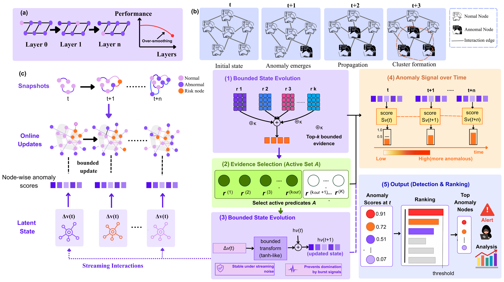
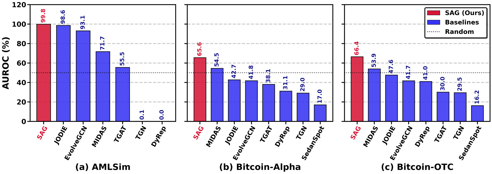
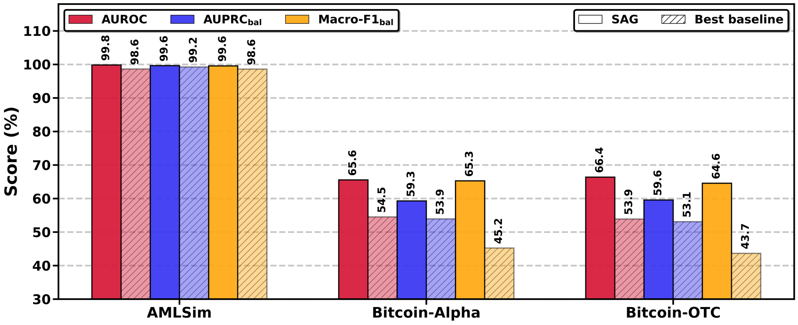
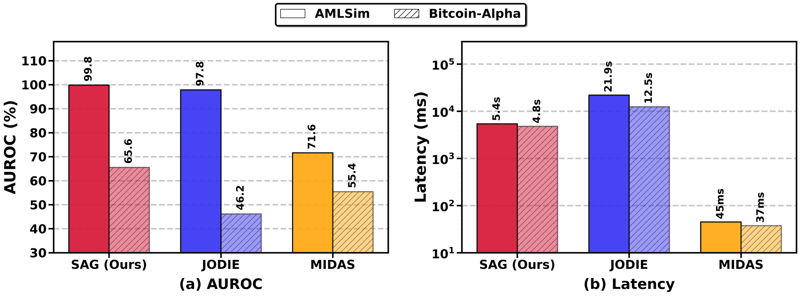

<div align="center">

# SAG: Stable and Efficient Anomaly Detection in Streaming Graphs

**Bounded state evolution for node-level anomaly detection on interaction streams**


</div>

SAG formulates node-level anomaly detection on interaction streams as the evolution of a **bounded node state**. Each interaction deposits calibrated anomaly evidence into the state of its endpoints through a decayed, saturating, and exposure-scaled update, realized online by a multi-timescale kernel sketch at **O(1) cost per interaction**. The state is provably bounded independently of node degree, interaction frequency, and graph size, and SAG runs in a **single, training-free pass**, including inside a graph database.

---

## Framework

<p align="center">
  
</p>

1. **Bounded state evolution:** $h_v \leftarrow \gamma\, h_v + \beta_{\mathrm{upd}}\, \tanh(\alpha\,\Delta_v) / (\log(1+\lambda_v)+\delta)$, with $|h_v| \le \beta_{\mathrm{upd}} / (\delta(1-\gamma))$ for every stream.
2. **Evidence selection:** heterogeneous evidence (streaming state, attribute deviation, structural statistics) is rank-normalized into predicate functions on the node set and selected by label-free rank-consistency constraints, either anchored on the streaming state or by consensus over all predicates (`fusion_consensus`).
3. **Kernel sketch:** an $R$-dimensional multi-timescale sketch computes the kernel accumulation of edge evidence exactly online for any mixture of $R$ exponential kernels; no neighborhood expansion, message passing, or gradient training.

---

## Results

### Dynamic graph streams (real per-edge timestamps, single pass in time order)

| Method | AMLSim<br>Macro-F1 | AMLSim<br>AUROC | AMLSim<br>AUPRC | Bitcoin-Alpha<br>Macro-F1 | Bitcoin-Alpha<br>AUROC | Bitcoin-Alpha<br>AUPRC | Bitcoin-OTC<br>Macro-F1 | Bitcoin-OTC<br>AUROC | Bitcoin-OTC<br>AUPRC |
|---|:-:|:-:|:-:|:-:|:-:|:-:|:-:|:-:|:-:|
| TGN | 33.3 | 0.1 | 31.1 | 40.0 | 29.0 | 37.2 | 39.1 | 29.5 | 37.2 |
| JODIE | 98.6 | 98.6 | 99.2 | 49.4 | 42.7 | 42.9 | 50.6 | 47.6 | 45.2 |
| DyRep | 33.3 | 0.0 | 31.1 | 42.4 | 31.1 | 37.3 | 49.4 | 41.0 | 42.0 |
| TGAT | 59.4 | 55.5 | 66.2 | 47.0 | 38.1 | 40.6 | 40.0 | 30.0 | 37.4 |
| EvolveGCN | 82.7 | 93.1 | 93.4 | 46.0 | 41.8 | 43.5 | 45.0 | 41.7 | 44.9 |
| MIDAS | 70.2 | 71.7 | 75.2 | 45.2 | 54.5 | 53.9 | 43.7 | 53.9 | 53.1 |
| SedanSpot | – | – | – | 34.6 | 17.0 | 33.7 | 34.7 | 16.2 | 33.5 |
| **SAG (ours)** | **99.6** | **99.8** | **99.6** | **65.3** | **65.6** | **59.3** | **64.6** | **66.4** | **59.6** |

TGN, JODIE, DyRep, and TGAT use the official [DyGLib](https://github.com/yule-BUAA/DyGLib) implementations. Macro-F1 and AUPRC follow the balanced protocol of CoLA / DOMINANT. Raw per-run metrics: [`results/dynamic/`](results/dynamic/).

<p align="center">
  
</p>

<p align="center">
  
</p>

### Neo4j deployment on dynamic streams

Each interaction is stored as an `:INTERACT` relationship with its real timestamp; the stream is re-queried with `ORDER BY r.t` and scored online (100k edges, mean of 2 runs).

| Dataset | Method | AUROC (%) | Latency (s) | Peak memory (GB) |
|---|---|:-:|:-:|:-:|
| AMLSim | JODIE | 97.8 | 21.9 | 2.36 |
| AMLSim | MIDAS | 71.6 | 0.04 | 2.36 |
| AMLSim | **SAG** | **99.8** | 5.4 | 2.36 |
| Bitcoin-Alpha | JODIE | 46.2 | 12.5 | 2.36 |
| Bitcoin-Alpha | MIDAS | 55.4 | 0.04 | 2.36 |
| Bitcoin-Alpha | **SAG** | **65.6** | 4.8 | 2.36 |

<p align="center">
  
</p>

---

## Project structure

```
.
├── run.py                       # main entry point (train / eval / ablation / benchmark)
├── configs/
│   ├── default.py               # SAG hyperparameters (gamma, beta_upd, alpha, delta, rho, R)
│   ├── dataset_configs.py       # per-dataset settings (static benchmarks + dynamic streams)
│   └── revision/                # YAML sweeps: sensitivity, predicate ablation, seed variance
├── src/
│   ├── models/                  # SAG: bounded state evolution, kernel sketch, Bayesian scorer,
│   │                            #      evidence selection, ablation variants
│   ├── baselines/               # official wrappers: static GAD, streaming (MIDAS, NetWalk,
│   │                            #      SedanSpot), temporal GNNs via DyGLib, LLM-based methods
│   ├── data/                    # loaders, anomaly injection, edge ordering, temporal datasets
│   ├── evaluation/              # AUROC / AUPRC / Macro-F1 (incl. balanced protocol)
│   ├── trainer/  tuning/  utils/  visualization/
├── experiments/                 # one driver per experiment
│   ├── run_comparison.py        # benchmark comparison (Tables 2-3)
│   ├── run_dynamic_comparison.py# dynamic graph streams (Table 4)
│   ├── neo4j_benchmark.py       # Neo4j evaluation on benchmarks (Table 5)
│   ├── run_neo4j_dynamic.py     # Neo4j evaluation on dynamic streams
│   ├── run_ablation*.py         # ablation studies
│   └── run_parameter_sensitivity.py, run_neo4j_sensitivity.py, ...
├── scripts/
│   ├── download_datasets.py, download_dynamic_datasets.py
│   ├── figures/plot_dynamic_streams.py   # regenerates the figures above
│   └── run_statistical_tests.py, run_all_parallel.py, ...
├── results/
│   ├── main_table/              # SAG output behind the benchmark tables (Tables 2-3)
│   ├── dynamic/                 # per-run JSON + aggregated CSV for dynamic streams and Neo4j
│   └── seed_variance/, ...      # per-seed records (deterministic scores)
├── docs/                        # dataset preparation and vendor-baseline notes
├── assets/                      # figures used in this README
└── setup_vendor_baselines.sh    # clones the official baseline repositories into vendor/
```

---

## Quick start

```bash
pip install -r requirements.txt          # core
pip install -r requirements_full.txt     # all baselines
bash setup_vendor_baselines.sh           # official baseline code (DyGLib, ...)

# benchmark graphs
python run.py --mode train --dataset Cora
python run.py --mode all_datasets

# dynamic graph streams (datasets: see docs/DYNAMIC_DATASETS.md)
python experiments/run_dynamic_comparison.py --dataset AMLSim \
    --methods SAG,TGN,JODIE,DyRep,TGAT,EvolveGCN-reimpl,MIDAS,SedanSpot --n_runs 3

# Neo4j deployment (requires a running Neo4j 5 instance)
export NEO4J_URI=bolt://127.0.0.1:7687 NEO4J_USER=neo4j NEO4J_PASSWORD=<password>
python experiments/run_neo4j_dynamic.py --dataset AMLSim --methods SAG,JODIE,MIDAS --edge_limit 100000 --n_runs 2
```

License-gated datasets are not redistributed; [`docs/DYNAMIC_DATASETS.md`](docs/DYNAMIC_DATASETS.md) and `scripts/download_*.py` give the sources and the expected `data/` layout.

---

## License and acknowledgments

The SAG source code is released under the **MIT License** (see [`LICENSE`](LICENSE)).

We thank the authors of DOMINANT, AnomalyDAE, CoLA, CONAD, GUIDE, ANEMONE, ComGA, ConsisGAD, PMP, GAAP, DySAT, Graphormer, GraphSAGE, HGT, MIDAS, NetWalk, SedanSpot, TGN, JODIE, DyRep, TGAT, EvolveGCN, DyGLib, TAPE, GraphGPT, HiGPT, and InstructGLM for releasing their implementations. Each baseline retains the license of its upstream repository; we invoke only their official entry points.
